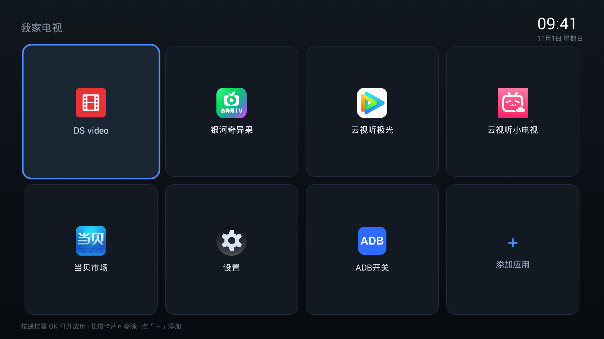

# 拯救老安卓电视 · rescue-old-android-tv

> 给 AI Agent（以及折腾老电视的人）用的操作手册 + 两个自带工具 APK：把 Android 4.x 老国产电视从"什么都装不上、满屏广告"救回可用状态。

[](#)
[](#)
[](LICENSE)

> **版本 V1.5** ｜ 作者：**B站-锤无双** ｜ 交流 QQ 群：**170621740**

来自一次真实抢救：**乐视 X3-43（MStar 6A918 / Android 4.3 / API 18 / EUI 6.0 / 已 root）**。最终结果：DS video 可用、银河奇异果/云视听极光/云视听小电视可用、无双桌面替代广告桌面、广告服务全部停用、ADB 与局域网推送全程可控。



## 自带两个 APK（不依赖第三方市场）

| APK | 包名 | 作用 |
|---|---|---|
| **无双ADB** `WushuangADB.apk` | `com.wushuang.adb` | 看 build.prop / IP / 内核 / root；一键开/关 ADB（含 root 模式）；开局域网推送页 `http://电视IP:8555/`——浏览器上传 APK 安装、网页卸载；**有 root 静默装，没 root 自动弹系统安装器让用户在电视上确认**；开机自启推送服务并自动开 ADB（装后需先打开一次） |
| **无双桌面** `WushuangDesktop.apk` | `com.wushuang.desktop` | 极简 HOME：深色卡片、统一 64dp 图标、24 小时时钟、左上角「无双桌面」、＋添加应用、长按移除 |

> 两个 APK 都是 minSdk 16（Android 4.1+），用仓库内固定密钥 `assets/signing/debug.keystore` 签名（口令 `android`），重编可覆盖升级。**无双ADB 的开 ADB / 装包 / 卸载需要 root；无双桌面安装不需要 root，但替换默认桌面通常需要停用原桌面（要 root）。**

## 下载两个 APK（最新版）

- **GitHub Release（推荐，附 SHA-256 可核对）**：https://github.com/chuiziyao/rescue-old-android-tv/releases/tag/v1.5.0
  - `WushuangADB.apk`：https://github.com/chuiziyao/rescue-old-android-tv/releases/download/v1.5.0/WushuangADB.apk
  - `WushuangDesktop.apk`：https://github.com/chuiziyao/rescue-old-android-tv/releases/download/v1.5.0/WushuangDesktop.apk
- **GitHub 仓库源文件**（与 Release 同一版）：https://github.com/chuiziyao/rescue-old-android-tv/tree/main/assets/prebuilt
- **SkillHub**：平台不允许直接上传二进制 APK，skill 包内以 Base64 文本附带；下载 skill 包后运行 `python scripts/decode_apk.py` 即可还原两个 APK 并校验 SHA-256。
- 国内网络访问 GitHub 慢/断时：可在交流 QQ 群 **170621740** 群文件获取，或使用你信任的加速方式。

> 版本对照：`WushuangADB.apk` 1.3（25,053 B，SHA-256 `AD8BC79A…75B7`）；`WushuangDesktop.apk` 13.0（16,927 B，SHA-256 `D39E90AD…7667`）。

## 关于 root：能不能"直接做掉"？

**结论：做不到通用自动 root。** root 依赖具体 SoC 的 bootloader/系统漏洞，不同机型方法完全不同；把提权漏洞打进 APK 既不通用也不安全。本项目不内置任何 root 漏洞。

但没有 SuperSU 也能用：

- 很多刷机 ROM 自带 `su`（SuperSU 只是管理器）：**用户不需要另装 SuperSU**，无双ADB 直接调用 `su` 即可开 ADB / 静默装包；如果 ROM 自带授权弹窗，点允许就行；
- 电视完全没 root：无双ADB 自动进**无 root 模式**——网页上传后电视弹系统安装器，点「安装」；卸载弹系统确认框。开 ADB 只能走厂商工程菜单；
- 换桌面：装无双桌面不需要 root；只有"停用原桌面"需要 root，部分电视允许 HOME 键弹窗里选「始终」，也能无 root 换。

## 已知限制：乐视 EUI 的主页键

乐视在 `system_server` 里用 `letv.desktop.DesktopManager` 劫持了 HOME 键，直接启动自家 `com.stv.launcher`，不走标准 Android HOME 解析。停用原桌面后，HOME 键会"空按"（logcat 里是 `Error while switching to desktop / NullPointerException`）。

替代方案：**按遥控器「返回」退出应用即可回到无双桌面**。其它品牌如果 HOME 不灵，先重启；仍不灵说明该 ROM 也劫持了 HOME。

## 它解决什么问题

- 电视提示"解析包错误"——根因是 APK 的 `minSdk` 高于电视 API，不是"内核太老"；
- 设置里找不到 ADB 开关——U 盘装无双ADB，点一下就有 ADB；
- 没有第三方应用市场 / 不会用 —— 无双ADB 自带 8555 推送页，浏览器就能装包/卸载；
- 满屏广告、桌面乱 —— `pm disable-user` 停广告服务 + 无双桌面替换；
- 冷门 App（DS video）没有兼容 TV 版 —— 手机版历史版本 + ADB 自动登录；
- 电视重启后 IP 变了 —— `python scripts/adb.py discover` 自动找回来。

## 三条铁律

1. **看 `ro.build.version.sdk`，别看厂商版本号**：EUI 6.0/8.0 实际是 Android 4.3（API 18）。
2. **能不能装只看 APK 的 minSdk**：`minSdk ≤ 电视 API` 才能装。
3. **别幻想刷机升级 Android**：老 SoC BSP 闭源、U-Boot 签名、无 recovery；想跑现代 App 就外接 Android 9+ 盒子。

## 快速开始

1. U 盘拷 `WushuangADB.apk` → 电视「文件管理」安装 → 打开 → SuperSU 允许；
2. 记下屏幕上的 `推送地址: http://<电视IP>:8555/`；
3. 电脑浏览器打开该地址 → 上传 `WushuangDesktop.apk` 安装；
4. 停用原桌面（`su -c pm disable-user --user 0 com.stv.launcher`，乐视例）→ 重启；
5. 需要电脑侧控制时：`python scripts/adb.py discover` 找 IP → `connect`。

详细流程见 [`SKILL.md`](SKILL.md) 和 [`references/playbook.md`](references/playbook.md)。

## 目录结构

```text
rescue-old-android-tv/
├── SKILL.md                    # Agent 主文档
├── references/
│   ├── playbook.md             # 完整抢救流程
│   ├── adb-cheatsheet.md       # 各品牌开 ADB、命令、按键码
│   ├── app-version-hunting.md  # 按 minSdk 找旧版 App（含实测兼容表）
│   ├── letv-918-notes.md       # 乐视 MStar 918 背景与刷机风险
│   └── troubleshooting.md      # 症状 → 原因 → 处理
├── scripts/
│   ├── adb.py                  # TV 控制助手（discover/cap/key/tap/install/upload…）
│   ├── check_apk.py            # 纯 Python 读 minSdk/ABI
│   ├── pardl.py                # 多线程分段下载
│   ├── build_assets.ps1        # 重编两个 APK
│   └── axml_patch.py           # 高级：硬改 minSdk（有风险）
├── assets/
│   ├── prebuilt/WushuangADB.apk
│   ├── prebuilt/WushuangDesktop.apk
│   ├── wushuang-adb/           # 无双ADB 源码
│   ├── wushuang-desktop/       # 无双桌面源码
│   └── signing/debug.keystore  # 固定签名密钥
└── docs/screenshots/
```

## 实测可用 App（Android 4.3 / API 18）

| App | 包名 | 版本 | minSdk |
|---|---|---|---|
| 银河奇异果（爱奇艺 TV） | `com.gitvdemo.video` | 16.10.0 | 16 |
| 云视听极光（腾讯 TV） | `com.ktcp.video` | 13.5.0.1010 | 老固件自带 |
| 云视听小电视（B 站 TV） | `com.xiaodianshi.tv.yst` | 老固件自带 | — |
| DS video 手机版 | `com.synology.dsvideo` | **3.3.3** | 16 |
| 哔哩哔哩手机版 | `tv.danmaku.bili` | 5.2.0 | 15 |
| 爱奇艺手机版 | `com.qiyi.video` | 8.0 | 14 |

## 作者

- 版本：**V1.5**
- 作者：**B站-锤无双**
- 交流 QQ 群：**170621740**
- V1.5：发布到 SkillHub（slug: wushuang-rescue-old-android-tv），版本对齐 GitHub Release v1.5.0。
- V1.4：去品牌化（全文不出现第三方市场名称）；无双桌面 13.0 默认卡片同步清理。
- V1.3：无双ADB 读设备信息不再走 `su`（SuperSU 只在开 ADB 时弹一次）；记录乐视 EUI 的 HOME 键被系统 `DesktopManager` 硬编码劫持，给出"返回键回桌面"方案。
- V1.2：无双ADB 无 root 模式（网页推送→系统安装器确认、系统卸载确认）、说明"为什么不能自动 root"。
- V1.1：新增无双ADB（信息/开ADB/局域网推送/开机自启）、无双桌面改名、固定签名密钥、IP 变化发现、HOME 键坑位。

## 免责声明

- 只应在**你自己的设备**上使用；停用系统服务、替换桌面、改 build.prop 都有风险，请先备份并能接受回滚。
- 无双ADB 的 8555 推送页与 ADB 5555 均为明文无鉴权，只在家用局域网临时开启，用完关闭。
- 本项目不包含任何厂商固件、签名密钥或破解工具（`assets/signing` 是公开的 debug 密钥），全部依赖设备自身开放的调试能力（开发者选项 / ADB / root）。
- 按 MIT 协议开源，不提供任何明示或暗示担保。

## License

MIT © 2026 B站-锤无双 · 交流 QQ 群 170621740
